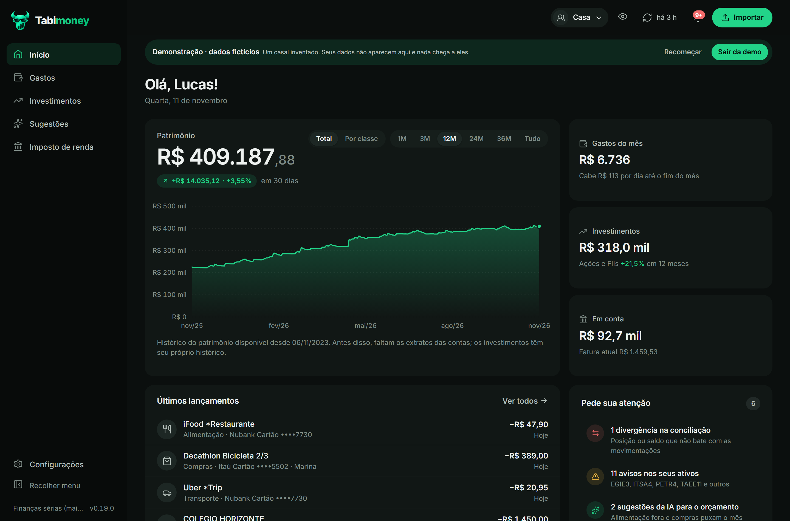
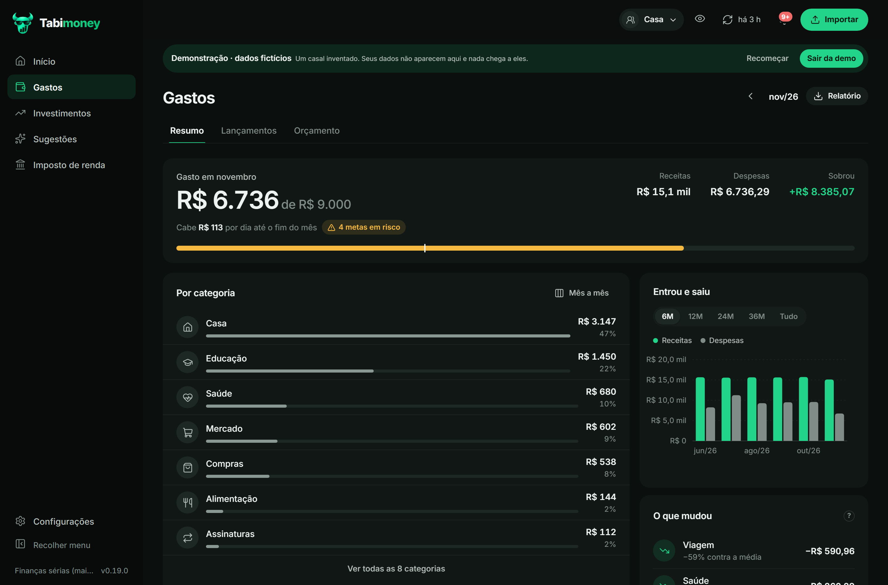
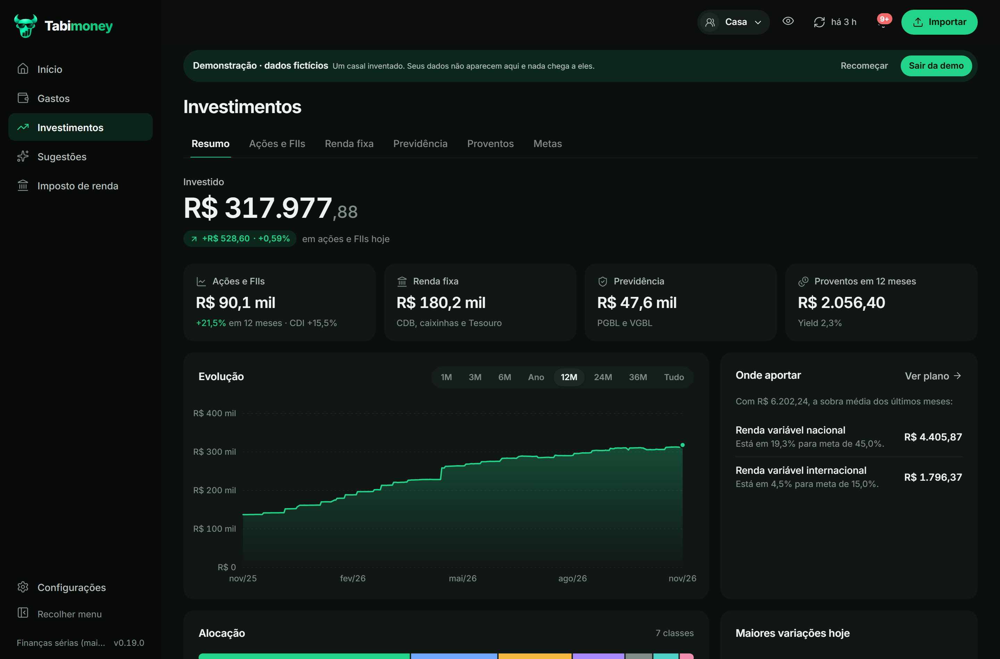

  

<h1 align="center">Tabimoney</h1>

  <strong>Suas finanças, do banco à carteira, no seu computador.</strong> 
  Contas, cartões, investimentos, orçamento e imposto de renda em um só lugar. 
  Sem conta em nuvem, sem assinatura e sem telemetria.

  
  

  
  
  

Windows 10/11 · macOS 11+ · sem instalar Python

Demonstração com dados fictícios. Os seus dados ficam só na sua máquina.

## Por que o Tabimoney?

Porque planilha não conta a história toda — e app de banco não mostra o que você realmente tem.

O Tabimoney junta o extrato, a fatura, a carteira e a declaração em uma visão só. Você entende para onde o dinheiro
foi, quanto pode gastar sem culpa, onde o próximo aporte faz diferença e quanto vai pagar de imposto. Tudo em um
aplicativo local, que abre no navegador e funciona offline.

- **Privacidade de verdade:** o banco de dados fica na sua pasta de usuário, criptografado em repouso com
  SQLCipher, e o servidor só aceita conexões do próprio computador. Não existe conta, nuvem ou telemetria.
- **Visão completa:** Open Finance pelo Meu Pluggy, importação de Nubank, B3, OFX e CSV, renda fixa, previdência e
  proventos.
- **Decisões melhores:** metas de alocação, fundamentos da CVM, teses de longo prazo e recomendações trimestrais.
- **Imposto sem susto:** estimativa do ano, PGBL, apuração da bolsa, deduções e declaração ficha por ficha.
- **IA quando você quiser:** um servidor MCP embutido conecta Claude, Codex, Cursor e outros agentes aos seus dados,
  com backup e correções reversíveis.

## O que você encontra

| | |
|---|---|
| **Contas e cartões** | Saldos, faturas e lançamentos de todos os bancos, com conciliação de transferências e Pix entre contas. |
| **Gastos e orçamento** | Resumo por categoria, comparação mês a mês, regras de categorização e metas de gastos com projeção. |
| **Investimentos** | Ações, FIIs, ETFs, renda fixa, previdência e caixinhas; preço médio, proventos e rentabilidade comparada a CDI e Ibovespa. |
| **Fundamentos** | Demonstrações da CVM, indicadores, avisos automáticos e histórico de teses por ativo. |
| **Metas** | Reserva de emergência, divisão entre renda fixa e variável, exposição internacional e plano do próximo aporte. |
| **Imposto de renda** | Estimativa anual, PGBL, imposto da bolsa, deduções de saúde e educação e roteiro da declaração. |
| **IA e automação** | Conecte seu agente, peça análises e deixe as correções e o trabalho repetitivo com ele. |

| Gastos | Investimentos |
|---|---|
|  |  |

## Comece em um minuto

1. **Baixe** o zip da sua plataforma na página de [Releases](https://github.com/Fishcake-Senpai/tabimoney-app/releases/latest).
2. **Extraia** e abra o `Tabimoney.exe` (Windows) ou arraste o `Tabimoney.app` para Aplicativos (macOS).
3. Na primeira vez, o sistema pode pedir uma confirmação extra porque o app não tem assinatura digital paga.
   É só liberar uma vez.
4. Pronto: o app abre no navegador em `http://127.0.0.1:8765`.

Não quer conectar seus bancos ainda? Abra a **demonstração** e explore todas as telas com dados fictícios.

O passo a passo completo, incluindo atualização, backup e solução de problemas, está em
[Instalação e atualização](docs/guia/instalacao.md).

## Seus dados são seus

O Tabimoney não tem servidor central. O banco SQLite é criptografado com SQLCipher e, junto com os backups novos e
o histórico, fica em `%LOCALAPPDATA%\FinancasPessoais` no Windows e em `~/Library/Application Support/Tabimoney` no
macOS. As chaves da base, do Meu Pluggy e da brapi ficam no Gerenciador de Credenciais do Windows ou no Porta-chaves
do Mac.

A internet só é usada para o que o app precisa: sincronizar o Open Finance, buscar cotações e dados públicos da
CVM e CDI, e verificar se há versão nova. Fora a sincronização autorizada do Open Finance, nenhum desses pedidos
leva seus dados financeiros. Entenda os detalhes em [Privacidade](docs/privacidade.md).

## Sua IA favorita, com contexto de verdade

O Tabimoney traz um servidor [MCP](https://modelcontextprotocol.io) embutido. Em **Configurações › Conectar à IA**,
conecte Claude Desktop, Claude Code, Codex, Cursor, VS Code ou Gemini CLI e peça, em qualquer conversa:

> “Revise meus gastos do mês.”
>
> “Onde devo aportar?”
>
> “Atualize minha tese da EGIE3.”

O agente lê gastos, carteira e metas, grava análises e correções e usa as mesmas proteções do app: nada é apagado, as
mudanças podem ser desfeitas e o servidor faz backup antes da primeira alteração de cada conversa. Veja
[IA e MCP](docs/guia/ia.md).

## Documentação

| Para usar | Para integrar | Para desenvolver |
|---|---|---|
| [Instalação e atualização](docs/guia/instalacao.md) | [IA e MCP](docs/guia/ia.md) | [Desenvolvimento](docs/desenvolvimento.md) |
| [Primeiros passos](docs/guia/primeiros-passos.md) | [Contrato com agentes](docs/agente-financeiro.md) | [Versionamento](docs/versionamento.md) |
| [Conexões e importação](docs/guia/conexoes-e-importacao.md) | [Modelos de relatório](docs/agentes/modelo-relatorio-tese.md) | [Estrutura do projeto](docs/desenvolvimento.md#estrutura) |
| [Gastos e orçamento](docs/guia/gastos.md) | [Exemplos JSON](docs/agentes/exemplos/) | [Testes](docs/desenvolvimento.md#testes) |
| [Investimentos](docs/guia/investimentos.md) |  |  |
| [Imposto de renda](docs/guia/imposto-de-renda.md) |  |  |
| [Privacidade](docs/privacidade.md) |  |  |

O índice completo, com o que cada documento cobre, está em [docs/README.md](docs/README.md).

## Contribuindo

Sugestões, correções e ideias são bem-vindas: abra uma issue ou envie um pull request para a branch `dev`. Antes de
mexer no código, leia [Desenvolvimento](docs/desenvolvimento.md) — ele explica como rodar, testar e manter a demo.

## Versões

O Tabimoney está em desenvolvimento ativo (`0.x`). A versão instalada aparece no rodapé do menu e em
`financas --version`. O que mudou em cada versão está no [CHANGELOG](CHANGELOG.md); as regras de lançamento e
publicação, em [Versionamento](docs/versionamento.md).

## Licença

O código é distribuído sob a [Licença Apache 2.0](LICENSE). A fonte Inter segue a SIL Open Font License
(`app/static/fonts/LICENSE-Inter.txt`). O nome, o logo e o mascote Tabimoney (`app/static/brand/`) não entram na
licença do código: em um fork ou versão modificada, use outro nome e outra marca.
