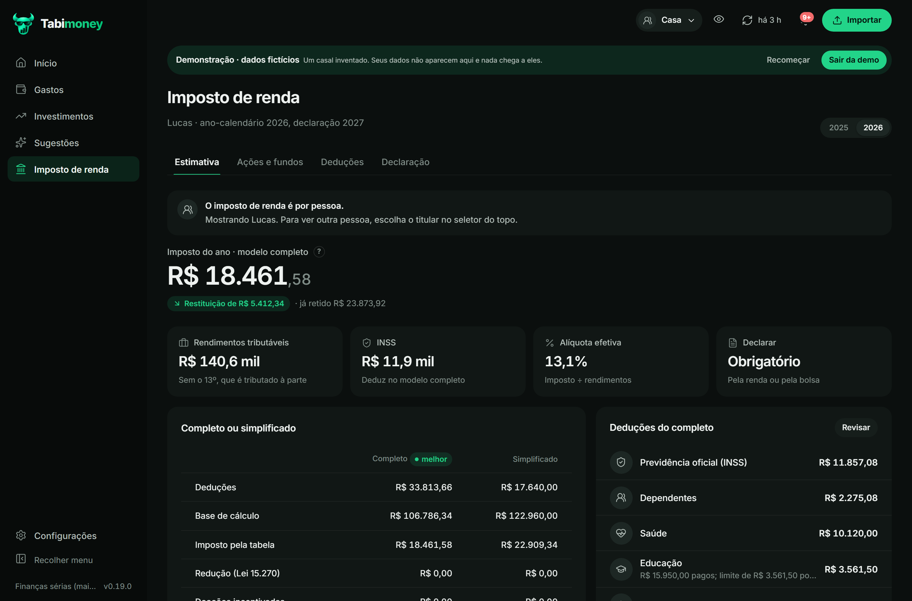

# Imposto de renda

A área de **Imposto de renda** ajuda a estimar o imposto do ano, apurar a bolsa, organizar deduções e preencher a
declaração. Ela é uma ferramenta de apoio: não substitui o programa da Receita nem a conferência dos informes.

O IR é **por pessoa**: use o seletor de titular no topo. Cada ano-calendário tem o seu conjunto de regras, limites e
fontes.

## Estimativa

Na aba **Estimativa**, cadastre de onde vem a sua renda:

- salário bruto CLT, por empregador, com 13º e mês de férias;
- pró-labore e faturamento da sua empresa (PJ), com regime tributário;
- outras rendas tributáveis;
- dependentes;
- INSS e IRRF do holerite ou do informe, se quiser substituir o cálculo automático.

O app calcula:

- INSS e imposto retido mês a mês;
- o 13º em separado;
- o ajuste anual nos modelos **completo** e **simplificado**;
- o melhor modelo e quanto vai restituir ou pagar;
- o comparativo entre o líquido esperado de cada mês e o salário que entrou no extrato.

Para PJ no Simples, a estimativa mostra o DAS, o fator R e o pró-labore mínimo para o Anexo III. Na PJ, só o
pró-labore entra no imposto da pessoa física e no limite do PGBL; o lucro distribuído é isento até o limite legal por
empresa e por mês.

## PGBL

A seção **PGBL**, dentro de **Estimativa**, mostra:

- o limite de **12% dos rendimentos tributáveis**;
- quanto você já aportou;
- quanto falta para completar o limite;
- quanto o aporte extra economiza, comparado com o melhor modelo.

A dedução do PGBL só existe no modelo **completo** e exige contribuir para o INSS ou regime próprio (ou ser
aposentado por eles). Só conta o que o **participante** pagou: o aporte da empresa não entra no limite e não é
dedutível. VGBL não deduz; vai em Bens e Direitos pelo valor aportado.

Quando o modelo simplificado já é melhor, o app avisa que o PGBL não ajuda naquele ano. A tela também lembra que o
benefício é **adiar** o imposto, não isentá-lo: no resgate ou benefício, o PGBL é tributado sobre aportes e
rendimentos.

## Ações e fundos

A aba **Ações e fundos** apura as vendas mês a mês:

- preço médio ponderado, juntando todas as corretoras do mesmo titular;
- taxas de corretagem e emolumentos no custo da compra e no valor da venda;
- isenção de **R$ 20 mil** por mês apenas para **ações e units**, quando o resultado das ações no mês é positivo;
- **15%** sobre o ganho comum (ações, units, BDRs e ETFs, ressalvadas as isenções);
- **20%** sobre day trade e **20%** sobre FIIs e Fiagros, com prejuízos separados por grupo;
- IRRF de 0,005% nas vendas comuns (quando passa de R$ 1) e 1% no day trade;
- DARF código **6015**, com vencimento no último dia útil do mês seguinte e mínimo de R$ 10 (o que ficar abaixo
  acumula para o mês seguinte);
- quanto ainda dá para vender de ações no mês sem imposto;
- bens e direitos em 31/12 **pelo custo**, não pelo valor de mercado;
- proventos do ano.

O app também lista **pendências** antes do resultado: venda sem custo, estoque negativo, ticker 11 sem classe,
bonificação sem custo, evento não suportado, IRRF estimado, taxas ausentes e prejuízo anterior não informado. Cada
pendência diz o que fazer.

O DARF é marcado como pago quando você confirma ou quando o app encontra um débito com “DARF” ou “Receita Federal”
no valor certo, entre o vencimento e 60 dias depois. A sugestão nunca é aplicada sozinha.

O que o app **não** faz: gerar o código de barras do DARF, calcular multa e juros de atraso (para isso, use o
Sicalc da Receita) ou substituir o informe da corretora.

## Deduções

Na aba **Deduções**, dê um tipo às categorias de gastos — por exemplo, **Saúde** e **Educação** — e os lançamentos
passam a contar. Farmácia, academia, curso livre e material escolar ficam de fora sozinhos.

- **Saúde:** sem limite, desde que o gasto tenha nota ou recibo com nome, CPF/CNPJ e endereço do prestador, quem
  pagou e o paciente. Reembolso do plano sai do valor.
- **Educação:** limite por pessoa (creche a pós-graduação, ensino técnico), com nota da escola e CNPJ. O que um
  dependente passa do limite não cobre o outro.
- **Dependentes:** valor fixo por dependente, com CPF.
- **Pensão alimentícia:** somente a judicial.
- **PGBL:** conforme o limite de 12%.

Você também pode lançar despesas pagas fora do extrato à mão. A aba mostra os totais por prestador, com CPF/CNPJ,
quem foi atendido e reembolso.

## Declaração

A aba **Declaração** monta o passo a passo ficha por ficha, na ordem do programa da Receita:

- Rendimentos tributáveis;
- Rendimentos isentos;
- Rendimentos sujeitos à tributação exclusiva;
- Renda variável;
- Bens e direitos;
- Pagamentos efetuados.

Cada valor tem um botão de copiar. A tela traz o checklist de documentos e avisos para conferir proventos que a
corretora mandou sem dizer se são dividendos ou JCP. O app **não gera o arquivo da declaração**: use os números como
conferência e compare com a declaração pré-preenchida ou o ReVar, se você autorizou.

## Regras, fontes e aviso de desatualização

Todos os números da Receita ficam em `app/services/ir/parametros.py`, por ano-calendário, com a fonte de cada valor.
O app cobre as regras de **2025** e **2026**, incluindo a Lei 15.270/2025 (isenção mensal até R$ 5 mil, redutor
anual, retenção de dividendos e tributação mínima de altas rendas).

A partir de abril, se a declaração daquele ano ainda não foi conferida com a publicação oficial, o app avisa no
sino e nas telas do IR que as regras podem estar desatualizadas. O aviso some quando uma versão nova revisa os
parâmetros (`EXERCICIO_CONFIRMADO`).

Fontes principais:

- [Perguntas e Respostas IRPF 2026](https://www.gov.br/receitafederal/pt-br/centrais-de-conteudo/publicacoes/perguntas-e-respostas/dirpf/p-r-irpf-2026-v1-00-2026-04-23.pdf/view)
  (Receita Federal, v1.0 de 23/04/2026);
- [Lei 15.270/2025](https://www.planalto.gov.br/ccivil_03/_ato2023-2026/2025/lei/l15270.htm);
- tabelas e portarias do INSS de cada ano;
- guias da Receita para a declaração e para a apuração de renda variável.

As regras completas de cálculo, com exemplos e decisões de borda, estão no código e nos testes
(`tests/test_ir_*.py`). O contrato com agentes de IA descreve as ferramentas `ir_*` em
[agente-financeiro.md](../agente-financeiro.md#7-imposto-de-renda).

> **Aviso:** confira sempre os valores com os informes de rendimentos e com o programa oficial da Receita. O
> Tabimoney é uma ferramenta de organização, não uma consultoria tributária.
